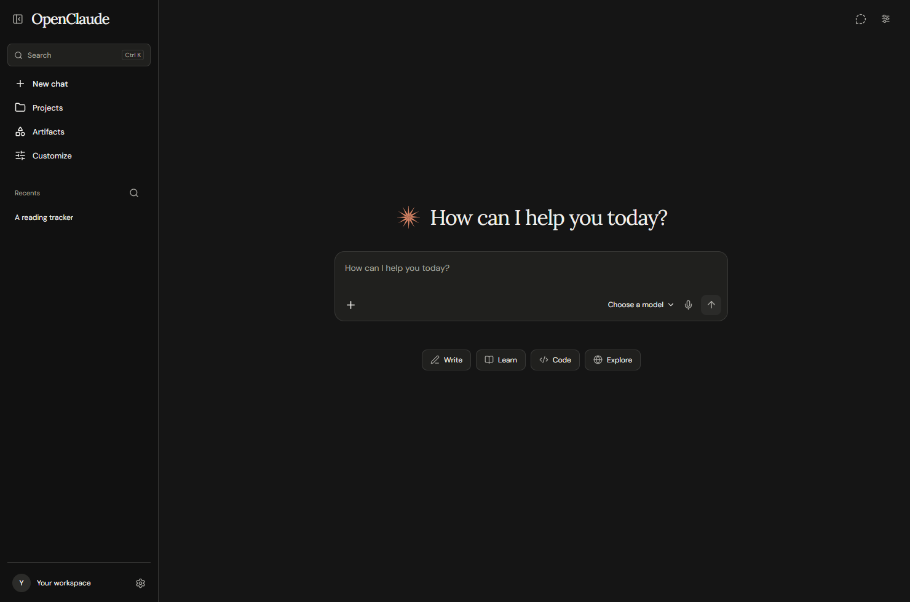
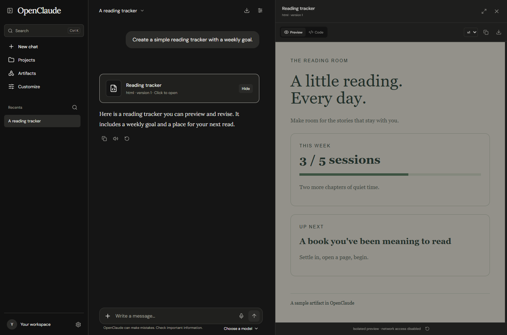
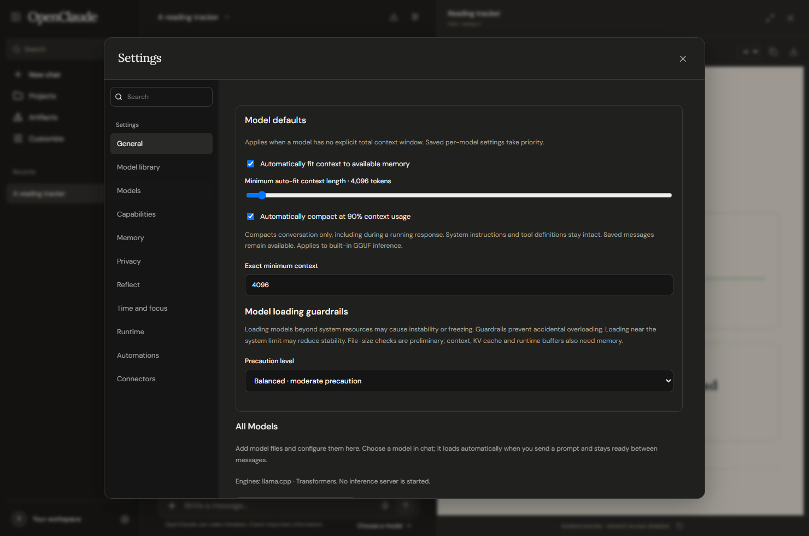
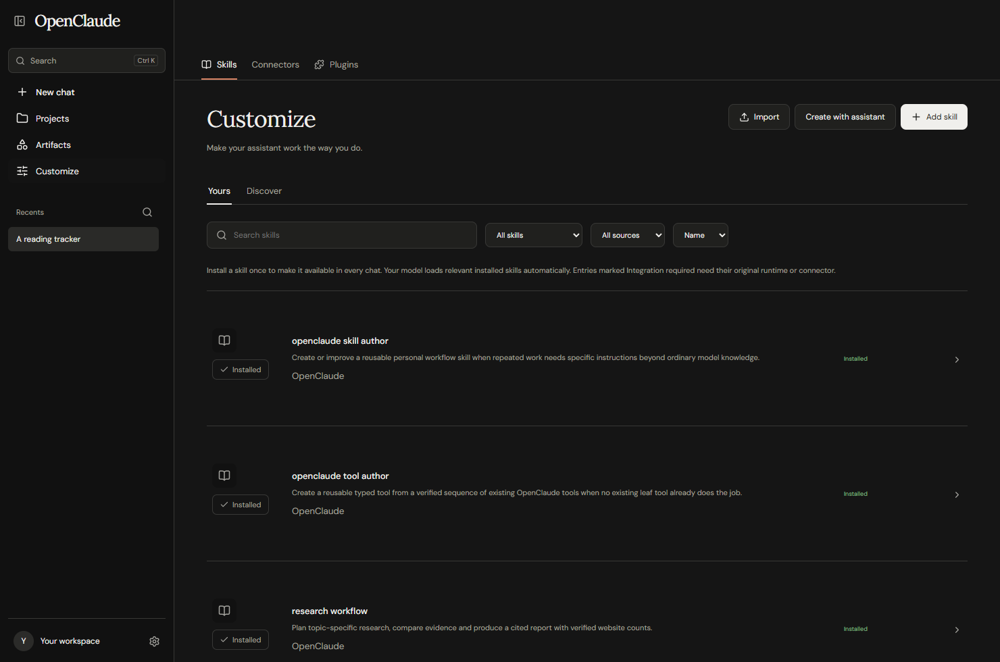

# OpenClaude

An open-source workspace for local AI: chat, versioned artifacts, web research, skills, and tools in a shared web interface and a native Windows desktop app.

OpenClaude connects to Ollama and OpenAI-compatible model servers. The desktop app also loads supported local models through a built-in inference worker, with direct GGUF inference through llama.cpp. Choose how you run your models and which capabilities the assistant can use.

**Early preview · 0.1.1 · Windows desktop + self-hosted web**

| Release file | Download |
| --- | --- |
| Windows installer EXE | [Download installer](https://github.com/gutsofpratik/OpenClaude/releases/download/v0.1.1/OpenClaude-0.1.1-windows-x64-setup.exe) |
| Portable ZIP | [Download portable ZIP](https://github.com/gutsofpratik/OpenClaude/releases/download/v0.1.1/OpenClaude-0.1.1-windows-x64-portable.zip) |
| SHA-256 checksums | [Download checksums](https://github.com/gutsofpratik/OpenClaude/releases/download/v0.1.1/SHA256SUMS.txt) |

[Download releases](https://github.com/gutsofpratik/OpenClaude/releases) · [Source](https://github.com/gutsofpratik/OpenClaude) · [Skills repository](https://github.com/gutsofpratik/OpenClaude-Skills) · [Report an issue](https://github.com/gutsofpratik/OpenClaude/issues)



Screenshots show the application running with an isolated sample workspace. The reading-tracker conversation and artifact are demonstration content.

OpenClaude is an independent project. It is not affiliated with, endorsed by, or an official client of Anthropic. It uses its own backend and assistant instructions. An Anthropic subscription is not required; models and external services have their own licenses and access requirements.

## What you can do

- **Chat with local models:** stream responses, attach files, edit messages into branches, retry responses, stop a run, organize projects, search saved chats, and use incognito conversations.
- **Create and revise artifacts:** keep one artifact identity across revisions, inspect earlier versions, view source, copy or download files, and preview supported HTML, Markdown, Mermaid, and other rendered content.
- **Work in a browser:** open real pages, navigate tabs, inspect page content, click, type, and capture screenshots. The desktop app uses native WebView2 pages; the web edition uses a backend browser with a visual viewer.
- **Use a real desktop terminal:** run PowerShell in a selected workspace folder, with native ConPTY output and an interactive terminal pane. This has the access of the Windows account running the app.
- **Use Windows computer control:** grant screenshot and keyboard/mouse access for supported workflows. This is separate from browser automation and from the optional Docker virtual desktop.
- **Search and research:** use ordinary web search, broader Deep Search, or a structured Deep Research report with a source inventory, progress, citations, and partial-result reporting.
- **Build a skill library:** install reusable instructions, import supported packages, create and update personal skills, and let the model load relevant instructions during a conversation.
- **Compose custom tools:** save typed workflows made from existing tools, passing inputs and results between steps while retaining each tool's normal permissions and availability checks.
- **Remember useful context:** explicitly save, search, update, and delete memories, and retrieve relevant saved conversation history. Memory is controllable and bounded.
- **Automate saved chats:** queue messages, schedule future prompts, and configure inbound/outbound webhooks. Scheduled runs require the app/backend to remain running.
- **Connect MCP services:** discover and invoke tools from compatible HTTP MCP servers, with OAuth, bearer token, or unauthenticated connections where supported by the server.
- **Generate documents with an optional worker:** run isolated PDF and Office document processing and supported skill scripts through the Docker runtime.

Capabilities depend on the edition, enabled settings, installed dependencies, model support, and permissions. A skill describes a workflow; installing it does not install every tool or service it mentions.

## Full tool list

OpenClaude registers **93 built-in tools**. The model discovers task-relevant tools through `toolkit`; it does not receive every detailed schema on every request. Tool availability depends on the edition, enabled permissions, installed runtimes, and model capabilities. This inventory lists supported operations, not a promise that every tool is available in every chat.

### Tool discovery and capabilities

| Tool | Purpose |
| --- | --- |
| `discover_tools` | Find and enable additional eligible tools for this run, such as PDF/Office generation, charts, files, browser or terminal. |
| `runtime_capabilities` | Get authoritative live tool and runtime status: embedded browser DOM interaction, desktop connection, screenshot interpretation, terminal, document worker and actual callable tool names. |
| `toolkit` | Single gateway to OpenClaude tools. |

### Files and calculation

| Tool | Purpose |
| --- | --- |
| `files_list` | List files and folders in this project workspace. |
| `files_read` | Read a bounded text file by workspace path. |
| `files_write` | Write UTF-8 text inside this workspace and return a real downloadable file. |
| `files_patch` | Apply one exact text replacement to a file; reject missing or ambiguous matches. |
| `files_search` | Find literal text in bounded project text files with matching line numbers. |
| `calculate` | Evaluate numeric arithmetic: + - * / % ^, parentheses, pi, e, sqrt, abs, min, max, pow, round, floor, ceil, sin, cos, tan, log, exp. |

### Memory, projects and conversation history

| Tool | Purpose |
| --- | --- |
| `memory_save` | Persist a useful personal fact, preference, decision or task outcome across chats and app restarts. |
| `memory_search` | Search durable facts, preferences and decisions across app restarts. |
| `memory_read` | Read the exact text of a saved memory by ID, paging long entries using next_offset. |
| `memory_update` | Update an existing explicit memory. |
| `memory_delete` | Forget one saved memory when explicitly requested. |
| `project_search` | Find matching project instructions, memories, and reference-source text. |
| `conversation_search` | Recover user and assistant text in THIS chat, including context omitted from the model window. |
| `conversation_read` | Read exact user or assistant source from the active branch of THIS chat. |
| `chat_history_search` | Search saved past chats for relevant user and assistant messages. |
| `chat_history_read` | Read a bounded page of user and assistant messages from a saved chat, excluding private reasoning and abandoned branches. |

### Plans and questions

| Tool | Purpose |
| --- | --- |
| `plan_create` | Create a visible task plan for a multi-step request. |
| `plan_read` | Read the current conversation task plans. |
| `plan_update` | Update one task status in an existing plan. |
| `ask_user` | Ask 1–3 focused clarification questions with 2–4 selectable options and free-text answers. |

### Artifacts and live drafts

| Tool | Purpose |
| --- | --- |
| `artifact_create` | Create a reusable artifact with complete actual source and a preview when supported. |
| `artifact_update` | Publish a complete new version of the same artifact. |
| `artifact_patch` | Publish one exact source replacement, preserving the artifact identity and all other source. |
| `artifact_list` | List saved artifacts in this chat or its explicitly selected project. |
| `artifact_read` | Read a bounded slice of actual artifact source, metadata, current version and full source hash. |
| `artifact_versions` | List saved version metadata without injecting every historical source. |
| `artifact_export` | Save a published artifact as a real downloadable workspace file. |
| `artifact_draft_read` | Read a bounded part of an unfinished draft in this chat. |
| `artifact_draft_resume` | Resume an unfinished saved draft in this chat without losing its source. |
| `artifact_draft_start` | Open the code panel before generating a substantial artifact. |
| `artifact_draft_write` | Write the current real source into an owned draft and display it in the code panel. |
| `artifact_draft_finish` | Save the complete drafted source as a real artifact and open its preview when its format supports one. |

### Skills and custom tools

| Tool | Purpose |
| --- | --- |
| `skill_create` | Create and install a reusable personal skill, immediately available in every chat. |
| `skill_update` | Improve a personal skill after reading it with skill_load. |
| `skills_list` | Discover globally installed skill workflows by name or topic, with bounded pagination. |
| `skill_load` | Load an installed skill when its purpose matches the current task. |
| `skill_read_resource` | Read a supporting reference file from a loaded skill package. |
| `skill_run_script` | Execute a supporting script from a loaded skill in the project sandbox. |
| `custom_tool_create` | Create and persist a reusable typed tool workflow. |
| `custom_tool_list` | List saved user-created tool workflows and their steps. |
| `custom_tool_delete` | Remove a user-created tool when the user requests removal. |

### Search and research

| Tool | Purpose |
| --- | --- |
| `research_read` | Read the saved research plan, counts, report and a page of verified source metadata in this chat. |
| `research_source_read` | Read actual fetched evidence from a saved research source by its returned source ID. |
| `web_search` | Search the configured provider (SearXNG or DuckDuckGo) and return real source URLs, titles, and excerpts. |
| `web_fetch` | Read a public webpage and return extracted text with its real source URL. |

### Browser

| Tool | Purpose |
| --- | --- |
| `browser_open` | Open a HTTP(S) page in the isolated browser and return observed element references. |
| `browser_find` | Find text in an owned desktop browser page; returns whether a match was found. |
| `browser_print` | Open the print dialog for an owned desktop tab only when the user requests printing. |
| `browser_zoom` | Set desktop browser page zoom (factor 1 = 100%). |
| `browser_emulate_device` | Enable or reset a mobile viewport in an owned desktop tab. |
| `browser_snapshot` | Inspect a browser tab and return current page text and element references. |
| `browser_click` | Click an observed browser element and return updated page state. |
| `browser_fill` | Fill an observed input field with text. |
| `browser_press` | Press a key in the selected tab or an observed element. |
| `browser_scroll` | Scroll a browser tab and inspect updated page state. |
| `browser_tabs` | List, select, or close owned browser tabs. |
| `browser_screenshot` | Capture the actual browser tab as a PNG. |
| `browser_download` | Observe and save a download triggered by clicking an observed element. |
| `browser_open_file` | OPEN an existing file/artifact, not scroll or inspect an already-open page. |

### Terminal

| Tool | Purpose |
| --- | --- |
| `terminal_run` | Run a command in the granted desktop PowerShell workspace when connected, otherwise in the project Docker Bash sandbox. |
| `terminal_read` | Read new output and status from an owned terminal job. |
| `terminal_stdin` | Send input to a running terminal job. |
| `terminal_cancel` | Cancel the terminal job and its child processes. |

### Computer control

| Tool | Purpose |
| --- | --- |
| `computer_screenshot` | Capture the granted Windows desktop scaled to 1280x800 when connected, otherwise the Docker virtual desktop. |
| `computer_click` | Click original screenshot coordinates on the granted desktop. |
| `computer_move` | Move the desktop pointer to screenshot coordinates. |
| `computer_drag` | Drag the desktop mouse between original screenshot coordinates. |
| `computer_scroll` | Scroll the granted desktop. |
| `computer_type` | Enter text on the selected desktop; Windows input uses Unicode keyboard events. |
| `computer_key` | Press a keyboard chord on the granted desktop. |
| `computer_wait` | Wait briefly and return a fresh desktop screenshot. |

### Documents, spreadsheets and media

| Tool | Purpose |
| --- | --- |
| `document_extract` | Extract actual text from an uploaded PDF, DOCX, spreadsheet, presentation, or text file. |
| `document_create` | Create and validate a real PDF or DOCX from headings, paragraphs, and tables. |
| `spreadsheet_inspect` | Read sheet names, values, and formulas from a registered XLSX file. |
| `spreadsheet_create` | Create a real XLSX workbook from named sheets and cell rows. |
| `slides_create` | Create a real PowerPoint presentation with title and content slides. |
| `chart_create` | Render a chart from a registered CSV file. |
| `image_transform` | Resize, crop, rotate, or convert a registered image file. |

### Clock, schedules, queues and webhooks

| Tool | Purpose |
| --- | --- |
| `message_queue_list` | List pending follow-up messages in this conversation. |
| `message_queue_add` | Queue a follow-up task only when the user explicitly asks for later/next work. |
| `message_queue_cancel` | Cancel an unstarted queued message in this conversation using its actual queue ID. |
| `webhook_list` | List configured webhook integrations permitted for agent calls. |
| `webhook_send` | Queue a JSON payload to an existing user-configured webhook, only for a user-authorized external action. |
| `webhook_delivery_status` | Inspect actual delivery status for a webhook sent from this conversation. |
| `webhook_events` | Read authenticated incoming webhook events for a configured integration. |
| `clock_now` | Read the live system clock, current date and time in an IANA timezone. |
| `schedule_create` | Schedule a user-requested future task/reminder in this saved chat. |
| `schedule_list` | List saved schedules and actual dispatch/error status for this conversation. |
| `schedule_update` | Pause/resume or reschedule a task belonging to this conversation. |
| `schedule_delete` | Delete a schedule from this conversation when the user requests cancellation. |

**Runtime requirements:** native terminal and Windows computer control require the desktop app and the relevant grants. Browser operations use the native desktop browser or the web backend browser. Document/media processing, sandbox execution, and skill scripts require their configured runtime, often the optional Docker worker. Computer screenshots require a vision-capable model for interpretation. Memory tools respect memory settings and incognito mode. Schedules require a running backend.

**Additional tools:** connected MCP servers register their own tools after authorization, and saved custom workflows can add `user_*` tools. Their names and availability vary by installation, so they are discovered at runtime rather than presented as fixed built-in entries here. Skills supply instructions; installing a skill does not itself add missing tool implementations.

## Desktop and web

The desktop and web source are both part of this repository. They share the React interface, local API, conversations, artifacts, skills, tools, and research system.

| Capability | Windows desktop | Self-hosted web |
| --- | --- | --- |
| Chat, projects, attachments, artifacts, memory, skills | Yes | Yes |
| Ollama / OpenAI-compatible providers | Yes | Yes |
| Native model management and built-in inference UI | Yes | Use a configured model provider |
| Browser | Native WebView2 tabs | Backend Playwright browser and visual viewer |
| Real host terminal | Native PowerShell / ConPTY | No native desktop terminal |
| Host computer control | Windows, with an explicit grant | No Windows host control |
| Search, research, HTTP MCP connectors, schedules, queue, webhooks | Yes, with prerequisites | Yes, with prerequisites |
| Docker document worker | Optional | Optional |

The Windows app uses Tauri and Rust with Microsoft WebView2. The browser edition runs locally through a Node.js backend; it is not a static HTML export or a hosted multi-user service.



## Download and run on Windows

Get the **portable ZIP** or **Windows installer EXE** from the [Releases page](https://github.com/gutsofpratik/OpenClaude/releases). Release availability and exact filenames are listed there. MSI packaging is not the release format.

1. For the portable build, extract the entire ZIP into a writable folder and launch `OpenClaude.exe`. Keep its bundled resources beside the executable. For the installer, run the setup EXE and launch OpenClaude from its shortcut.
2. The installer checks for WebView2 and installs Microsoft’s signed Evergreen runtime when missing. Portable users can run `Setup-Dependencies.cmd` for dependency setup. Internet access is required for missing dependencies.
3. Select a model provider, or open the desktop model library to import/download a supported local model.
4. If using built-in inference, install the relevant inference runtime when prompted. Model weights and optional inference dependencies are separate downloads; the application download is not an offline bundle of every model and backend.
5. Choose a model in the composer and start a chat. Enable other capabilities as you need them.

Desktop packages include the local backend, Node runtime, and a standalone Python runtime. They do not require an npm development server. Python/inference setup, model downloads, GPU dependencies, and the optional Docker worker may still be required for the features you choose.

**Unsigned early preview:** initial Windows builds may display a SmartScreen or publisher warning because code signing is not yet established. Download only from this project's release page and inspect the release notes. Preview builds may have rough edges or require runtime setup.

## Run from source

### Prerequisites

- Node.js **22.19 or newer**, npm, and Git.
- For native Windows development: Rust/Cargo, Microsoft C++ build tools with the Windows SDK, and Microsoft Edge WebView2 Runtime. Native npm dependencies can also require the C++ toolchain.
- For built-in model inference: a compatible Python environment and the dependencies required by the selected engine. GPU execution additionally needs a compatible GPU, driver, and runtime build.
- For web browser automation: installed Chrome or Playwright Chromium.
- **Optional:** Docker Desktop with a working Linux container engine for document processing, sandbox jobs, and the bundled SearXNG service. Docker is not required for ordinary chat, native PowerShell, or built-in inference.

```powershell
git clone https://github.com/gutsofpratik/OpenClaude.git
cd OpenClaude
npm install
```

### Web development

```powershell
npm run dev
```

Open [http://127.0.0.1:5173](http://127.0.0.1:5173). The API listens on [http://127.0.0.1:3001](http://127.0.0.1:3001).

Start Ollama separately if that is your provider. Its usual local address is `http://127.0.0.1:11434`. Settings also accepts OpenAI-compatible server endpoints, including compatible local model servers.

For browser automation without an installed Chrome:

```powershell
npx playwright install chromium
```

### Production web build

```powershell
npm run build
npm start
```

Open [http://127.0.0.1:3001](http://127.0.0.1:3001). The backend serves the compiled web interface. The server binds to loopback by default. Remote access, authentication, and secure deployment are separate responsibilities; this preview does not provide a multi-user account system.

### Native Windows development

```powershell
npm run desktop:prepare
npm run desktop
```

The desktop launcher builds the desktop interface and starts or connects to the local backend. Port 3001 must be available for OpenClaude; it does not replace an unrelated service occupying that port.

```powershell
npm run release:package
```

This release command builds both frontends, the native app, and the bundled backend, then writes an installer EXE, portable ZIP, and SHA-256 checksums under `release/`. It downloads checksum-pinned Python and NSIS inputs and requires network access. The optional GitHub Actions workflow builds the same packages on Windows. No models, private data, CUDA drivers, or Docker Desktop binaries are bundled.

### Windows release signing

The existing v0.1.1 download is an **unsigned preview**. This source now requires a signing identity for normal release builds; it does not retroactively sign published files.

Use a publicly trusted code-signing certificate with its private key available through the Windows Current User certificate store (including a hardware-token provider), and set `OPENCLAUDE_SIGN_CERT_SHA1` to its thumbprint. Alternatively, set both `OPENCLAUDE_SIGN_DLIB` and `OPENCLAUDE_SIGN_METADATA` to the Microsoft Artifact Signing client library and account/profile metadata paths, and authenticate with that service outside the repository. Artifact Signing requires a compatible current Windows SDK and a public-trust certificate profile. A signing subscription or certificate is not included with OpenClaude.

The packager selects the latest installed x64 Windows SDK SignTool; `OPENCLAUDE_SIGNTOOL` can override its path. The app EXE and dependency setup PowerShell script are signed before packaging, NSIS signs the generated uninstaller, and the installer is signed before SHA-256 checksums are written. Each operation requires SHA-256, an RFC 3161 timestamp, and successful Authenticode verification. Third-party binary signatures are preserved. The portable ZIP contains the signed app; ZIP archives do not themselves support Authenticode signatures.

For local testing only, explicitly use `npm run release:package -- --unsigned`, or enable the workflow's `unsigned_preview` input. For signed CI builds, provision the certificate/token or Artifact Signing client, credentials, and metadata on the runner and set the matching repository variables. The workflow does not install a certificate, obtain a signing identity, or authenticate to Azure for you. Keep private keys, signing credentials and metadata outside Git. Self-signed/test certificates do not establish public publisher trust. A valid signature does not guarantee the absence of SmartScreen reputation warnings.

### Optional document and search runtime

```powershell
npm run runtime:up
npm run runtime:health
```

Settings → Runtime reports engine/image availability. The Docker worker provides document processing and isolated jobs; it is a different execution environment from native Windows terminal and computer tools. SearXNG uses local port 8081 in the supplied runtime configuration.

## Local model management



The desktop model library can browse Hugging Face publishers, inspect model files and licenses, download pinned revisions, and manage local model files. Imported Ollama model information can also provide configuration for supported local GGUF files. A file being discoverable does not guarantee that its architecture or chat template is supported by every engine.

### Engines and platforms

| Engine / backend | Intended use | Requirements and limits |
| --- | --- | --- |
| llama.cpp CPU | Direct quantized GGUF inference | Compatible GGUF architecture and pinned Python binding/runtime |
| llama.cpp CUDA | GGUF GPU offload | Compatible NVIDIA GPU, drivers, CUDA runtime, and GPU-enabled binding |
| Prism | Explicit alternative GGUF CUDA backend | Windows + NVIDIA CUDA; a matching prepared binary/binding manifest is required |
| Transformers | Supported non-GGUF model folders | Compatible Python/PyTorch/Transformers dependencies and sufficient memory |
| MLX | MLX-compatible model folders | Apple Silicon macOS only; it is not a Windows backend or a promise of a packaged Mac desktop release |

Ollama and OpenAI-compatible servers run as separate providers. Built-in inference uses a private worker process rather than requiring an Ollama server or a public llama-server endpoint.

Per-model settings include context and output limits, sampling, device selection, GPU layers, KV cache precision, batching, prompt caching, and supported adapter configuration. Loading guardrails can limit model size. Automatic fitting and supported allocation retries help choose workable settings, but model weights, KV cache, context, and runtime buffers all consume real RAM/VRAM. Caching reduces repeated work when applicable; it does not increase a model's memory capacity or make an oversized model fit for free.

Vision requires a supported model and, for relevant GGUF workflows, a compatible projector. Tool calls require a compatible chat template/protocol. Reasoning display depends on actual model/runtime output. Selecting a capability in settings does not add that capability to an unsuitable model.

The runtime pack list distinguishes available integrations from entries marked **Not integrated**. Vulkan, ExecuTorch, CUDA speech recognition, and Harmony-specific packs are not usable merely because they appear in that list. Prism is an explicitly prepared backend, not a universal download-and-run option.

## Chat, artifacts, and files

Chat supports streaming, cancellation, response actions, edited branches, projects, attachments, and saved-chat search. The activity view shows tool work and runtime events. Reasoning is displayed when the selected model and provider expose it.

Artifacts have persistent identities and revisions. Ask the assistant to change an existing artifact and it can update that artifact while keeping earlier versions available. The viewer includes preview/source views, copy, download, resizing, and expanded views. Draft previews are held back until the draft is complete enough to execute safely in the preview context.

Generated documents and files appear as download cards. Native-language source can be saved as a file, but writing code does not imply that the app can compile or simulate every target platform; for example, Windows does not provide native iOS compilation.

## Browser, terminal, and computer tools

Desktop browser tools operate real WebView2 pages through observed page state and references. Browser management includes history/download views, cookie import, browsing-data controls, and supported password/autofill preferences. **Password import from another browser is not available.** Extension loading is limited to trusted **unpacked extension folders** containing a manifest; there is no extension-store installer.

The web edition's browser is a backend Playwright browser with a screenshot-based viewer and interactions. It has its own sessions and network restrictions. It does not mirror the user's ordinary Chrome profile.

The native terminal uses PowerShell and ConPTY in the workspace you select. It runs real commands against real files. Computer tools can capture the Windows display and send mouse/keyboard input after the desktop grant. Browser sessions, tool jobs, and cancellation are coordinated with the active conversation. Website behavior, dialogs, authentication, screen layout, and model quality can still affect success.

Docker sandbox terminal/browser/virtual-desktop jobs, where enabled, act inside the container. They do not grant Windows host access.

## Search, Deep Search, and Deep Research

Search supports SearXNG and DuckDuckGo, including an automatic fallback mode. Source reading and the research coordinator keep track of actual retrieved pages and citations.

| Mode | Output |
| --- | --- |
| Web search | Results and page evidence used in an ordinary conversation |
| Deep Search | Broader discovery and reading followed by a direct chat answer with citations |
| Deep Research | A planned research workflow and a longer report with evidence, competing views, gaps, and limitations |

The coordinator has bounded discovery, time, and model budgets. Its website targets are goals, not guaranteed counts. Rate limits, inaccessible sites, duplicate domains, poor search results, cancellation, or inference failures can produce a partial result. Progress and reports should be read alongside their source counts and limitations. OpenClaude does not guarantee that every query reads 100 websites or that every generated conclusion is correct.

## Memory and conversation history

Explicit memory tools can save, search, update, and delete useful information. Saved-chat retrieval finds relevant earlier messages. The model receives selected memories and contextual history within its current token budget, with compaction available for longer conversations.

This is not unlimited recall. Retrieval can miss context, summaries can lose detail, and every model has a finite context window. Review important remembered information in settings and delete it when appropriate. Memory can be disabled. Incognito conversations cannot use persistent cross-chat memory tools; incognito is an application behavior, not an operating-system privacy guarantee for external providers, files, or tools.

## Skills and custom tools



Install a skill once to make its description discoverable across chats. The assistant can load relevant instructions when needed. Personal skills can be authored and revised in the app or by supported authoring tools; Markdown/ZIP imports and supported skill plugin packages are also available. Uninstall removes a skill's active registration while retaining local resource files.

The public companion repository is [OpenClaude-Skills](https://github.com/gutsofpratik/OpenClaude-Skills). Check each package's origin and license. Third-party skills keep their own terms and may describe tools that are unavailable in your environment.

Supported plugin imports use `.claude-plugin/plugin.json` and `skills/<name>/SKILL.md`. Hooks, commands, agents, and MCP extensions inside uploaded skill plugins are rejected. Importing a skill does not execute uploaded host code. Supported skill scripts require the execution runtime.

Custom tools are persistent, typed compositions of existing leaf tools. Steps can reference declared inputs and earlier step results. Workflows retain normal permission, edition, availability, privacy, and cancellation checks. They cannot recursively call custom workflows, evaluate arbitrary workflow code, or bypass the tool gateway.

## Connectors, schedules, queue, and webhooks

**Connectors:** compatible HTTP MCP servers can expose tools through discovery and schema-validated execution. Configure OAuth, a bearer token, or no authentication according to the server. OAuth compatibility depends on server discovery, registration, and callback requirements. This is not a preconfigured integration for every commercial service, and local stdio MCP servers are not the HTTP connector transport.

**Queue:** send follow-up messages while a response is running. Queued work is processed in conversation order; after failures or restarts, pending work can pause for review and resume. Queuing does not make a single model execute an unlimited number of tasks at once.

**Schedules:** save future prompts in saved conversations, including optional fixed-interval repetition. The backend must remain running, and the selected model and tool prerequisites must be available. Repetition uses elapsed intervals rather than a full calendar/DST scheduling engine. Scheduling does not grant additional permission for external actions.

**Webhooks:** configure inbound bearer-authenticated events and outbound deliveries, including optional signing, delivery history, retries, and status reporting. These require a running backend and reachable endpoints. Inbound events enter the webhook inbox; receiving an event is not itself permission to perform arbitrary actions.

## Data and privacy

- Source runs store application state in `.local/state.sqlite`, with uploads, generated files, skill resources, runtime state, and logs under `.local`. These are excluded from Git. Packaged desktop backend state is stored under `%LOCALAPPDATA%\OpenClaude\data`; its native browser profile is managed separately by Tauri in the application data directory.
- Local model execution can keep inference on your machine. Configured remote providers, connectors, webhooks, searches, visited websites, and model downloads communicate with their respective services.
- Browser cookies, connector credentials, conversation content, and files can be sensitive. Treat the local data directory as private application data. Do not assume encryption at rest or a secure credential vault.
- The API binds to `127.0.0.1` by default. This preview is designed as a personal local workspace, with origin and tool-policy checks rather than a hosted account/billing system.
- Native terminal and computer actions have real effects. Tool grants and workspace selection define what is available; model output still needs judgment.

Do not commit `.local`, downloaded model weights, private provider settings, tokens, browser profiles, or personal conversation exports when contributing.

## Architecture

```text
React + Vite interface
  ├─ Web browser
  └─ Tauri / Rust Windows host
       ├─ WebView2 browser
       ├─ PowerShell / ConPTY terminal
       └─ Granted Windows capture and input
             │
             ▼
Local Fastify API + SQLite
  ├─ Agent orchestration, streaming, branches, queue, compaction
  ├─ Tools, permissions, artifacts, files, skills, memory
  ├─ Research, schedules, webhooks, HTTP MCP connectors
  ├─ Ollama / OpenAI-compatible provider adapters
  ├─ Private Python inference workers
  └─ Optional Docker document / sandbox worker + SearXNG
```

| Directory | Role |
| --- | --- |
| `src/` | Shared interface, chat, artifacts, settings, desktop integration |
| `server/` | Local API, agent, providers, storage, tools, skills, research |
| `src-tauri/` | Native Windows host, browser, terminal, computer bridge, backend lifecycle |
| `runtime/models/` | Python model loading, generation, native engine integration, caching |
| `runtime/worker/` | Optional container jobs and document processing |
| `skills/` | Skill catalogs and appropriately licensed source packages |
| `scripts/` | Development, runtime, build, and packaging helpers |

## Development and validation

```powershell
npm run build
npm run build:desktop
npm run desktop:prepare
```

The public export contains the application and packaging source. Internal audit material and development test fixtures are excluded. Native and GPU behavior must also be checked on the target hardware.

When reporting a problem, include the edition/version, Windows version, provider or inference engine, model name/format, relevant non-secret settings, steps to reproduce, and sanitized logs. Do not attach tokens, private chats, or downloaded model files.

Contributions to both the web and desktop code are welcome. Keep changes focused, describe the user-visible behavior, and run checks appropriate to the change. For a new engine or tool integration, include availability checks and truthful error reporting when its prerequisites are missing.

## Current limitations

- Windows is the current native desktop target. Optional MLX code requires Apple Silicon macOS and does not establish a distributed Mac desktop build.
- Model quality, context size, tool calling, vision, and reasoning support vary. There is no universal model compatibility claim.
- Some listed runtime packs are explicitly not integrated. Initial model/runtime setup can require network access and significant disk space.
- Schedules, queue processing, connectors, and webhook delivery require a running backend. They are not a cloud scheduler.
- Browser password import and extension-store installation are unavailable. Unpacked extension support depends on WebView2 compatibility.
- Memory and research are bounded. Neither unlimited recall nor a guaranteed source count is promised.
- Voice conversations, cloud sharing, billing, and managed user accounts are not implemented local services.
- This is an early preview. Unsigned builds, runtime dependencies, hardware-specific behavior, and incomplete workflows may need troubleshooting.

## License and third-party software

Original OpenClaude application code is licensed under **MIT**; see [LICENSE](LICENSE). Third-party code, skill packages, bundled runtimes, dependencies, model weights, fonts, and other assets retain their own licenses. See [THIRD_PARTY_NOTICES.md](THIRD_PARTY_NOTICES.md) and the notices distributed with each release.

Do not assume that the application's license relicenses every included skill or model. Redistribution of packages and binary dependencies must follow their individual terms. Release contents and notices should be audited before distribution.
